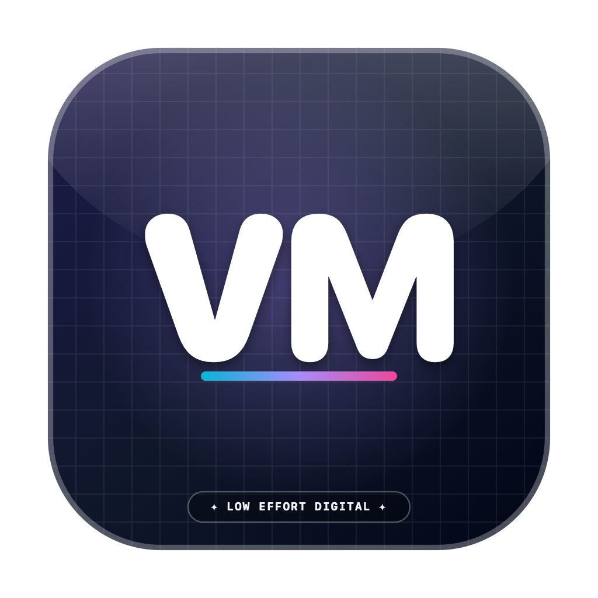
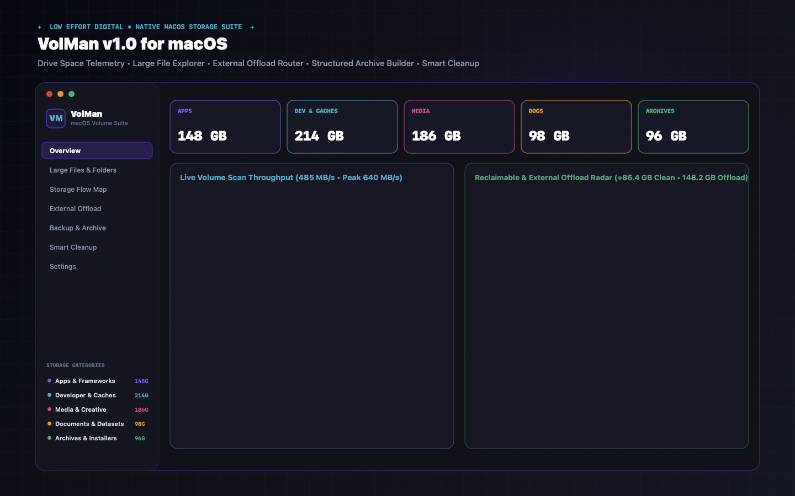
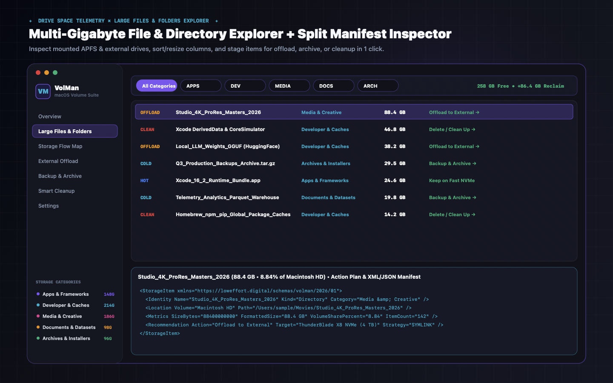
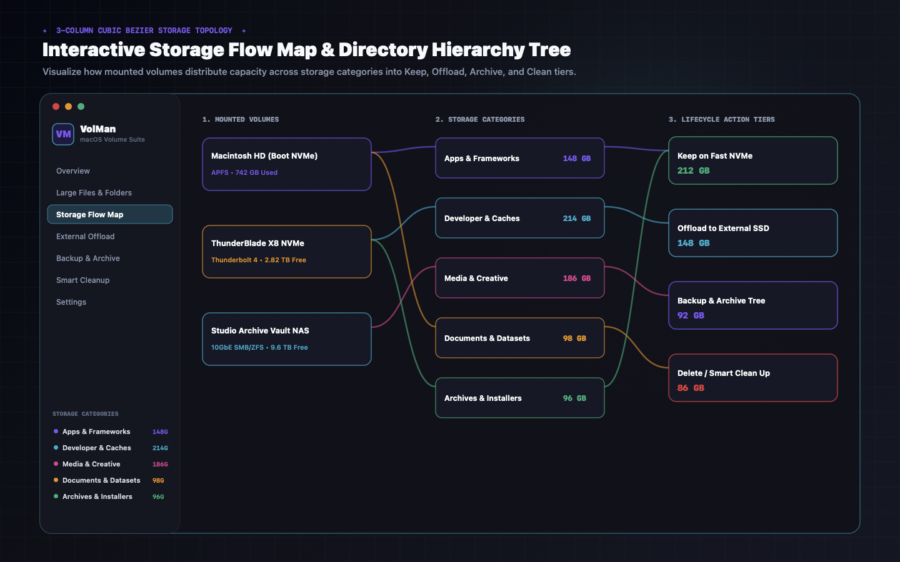
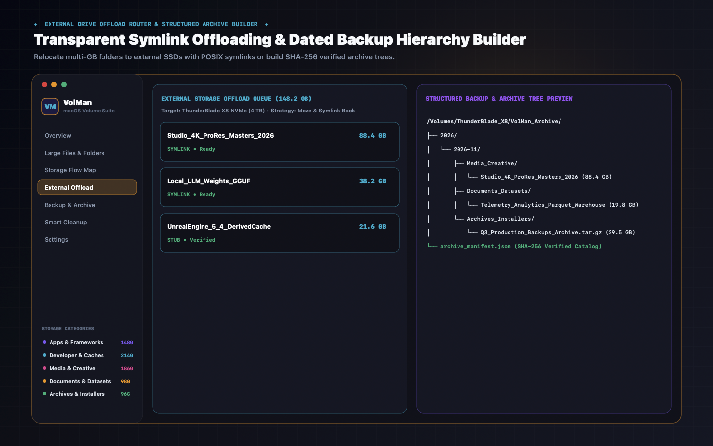
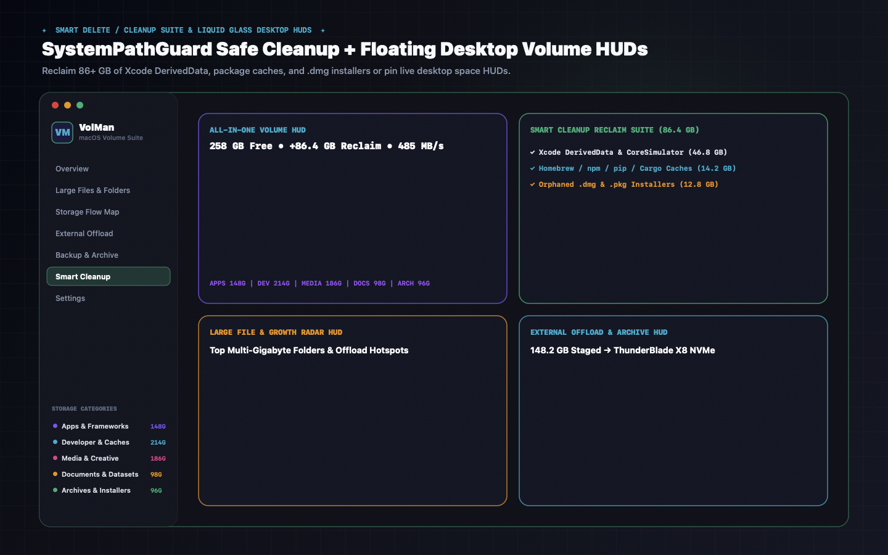
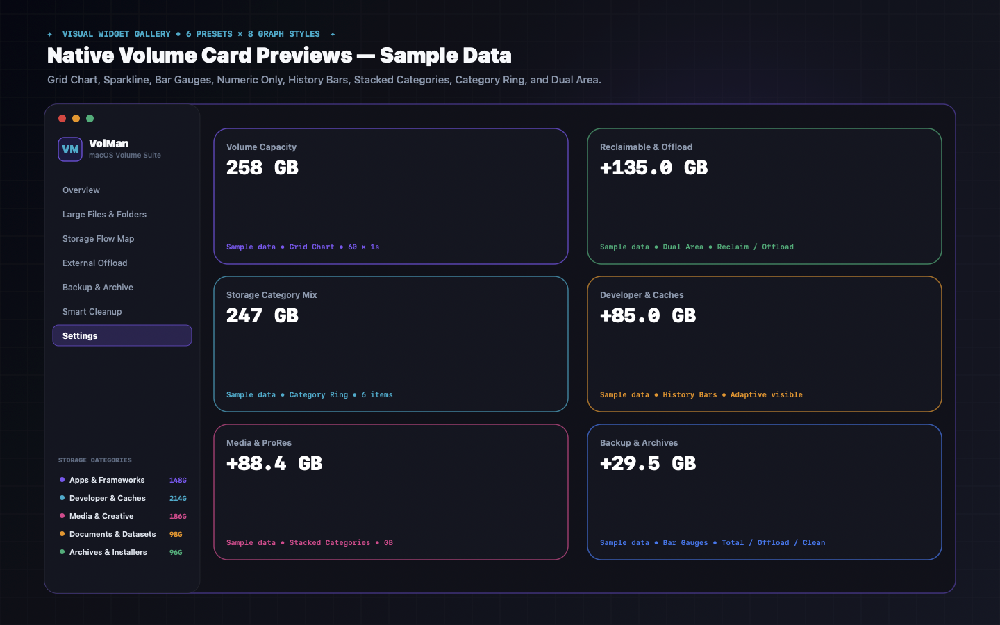

<div align="center">

<picture>
  <source media="(prefers-color-scheme: dark)" srcset="Resources/branding/loweffort_digital/svg/le_lockup_horizontal.svg">
  <source media="(prefers-color-scheme: light)" srcset="Resources/branding/loweffort_digital/svg/le_lockup_horizontal_light.svg">
  
</picture>

<br/><br/>



# VolMon for macOS (v2.0.0)

**Native macOS Drive Space Telemetry, Large File & Folder Explorer, External Storage Offload Router, Structured Backup & Archive Builder & Smart Cleanup Suite**

[](https://swift.org)
[](https://www.apple.com/macos)
[](LICENSE)
[](https://github.com/LowEffortDigital/VolMon/releases/latest/download/VolMon.dmg)



</div>

---

## Overview

**VolMon** (`MacVolumeManager`) brings pro-grade storage telemetry, multi-gigabyte file & folder inspection, transparent external drive offloading, deterministic backup/archive structuring, and safe cache cleanup to macOS—wrapped in the signature **Low Effort Digital** Liquid Glass aesthetic alongside [**PerfMon**](https://github.com/LowEffortDigital/PerfMon), [**EventMon**](https://github.com/LowEffortDigital/EventMon), and [**WebMon**](https://github.com/LowEffortDigital/WebMon).

---

## Key Features

### 1. Drive Space Telemetry & Large Files / Folders Explorer
- Inspects mounted **APFS boot drives**, **Thunderbolt / USB4 NVMe SSDs**, and **SMB / NAS shares** with live used, free, and purgeable capacity plus 5 storage categories:
  - **Apps & Frameworks** (`/Applications`, Xcode runtimes, SDK bundles)
  - **Developer & Caches** (`DerivedData`, `CoreSimulator`, `node_modules`, HuggingFace/Ollama model weights)
  - **Media & Creative** (4K/8K ProRes masters, Logic Pro sessions, Lightroom catalogs)
  - **Documents & Datasets** (Parquet warehouses, SQLite snapshots, project trees)
  - **Archives & Installers** (`.dmg`, `.pkg`, `.tar.gz`, `.ipsw`, Time Machine & cold snapshots)
- **Sortable, Resizable & Moveable Columns**: Click any column header (`★`, `Status`, `Name`, `Category`, `Kind`, `Size`, `% Drive`, `Items`, `Volume`, `Last Accessed`, `Action Plan`, `Full Path`) to sort ascending/descending, drag headers to reorder, drag dividers to resize width, or customize columns from the **Columns** menu.
- **Split Storage Item Inspector**: Inspect any file or directory in **General & Space**, **Offload / Archive / Clean Actions**, or **XML & JSON Manifest** view.



### 2. 3-Column Interactive Storage Flow Map & Directory Hierarchy Tree
- Visualizes storage allocation with smooth cubic Bezier curves across 3 columns:
  1. **Mounted Volumes & Containers** (`Macintosh HD`, `ThunderBlade X8 NVMe`, `Studio Archive Vault NAS`)
  2. **Storage Categories & Hot Directories** (`Apps`, `Developer`, `Media`, `Documents`, `Archives`)
  3. **Action & Destination Tiers** (`Keep on Fast NVMe`, `Offload to External`, `Backup & Archive`, `Delete / Clean Up`)
- Click any volume, category, or action tier node to isolate its flow links, or switch to the proportional **Directory Space Hierarchy Tree**.



### 3. External Storage Offload Planner & Symlink Router
- Offload multi-gigabyte folders and files to external Thunderbolt/USB4 SSDs or NAS volumes using 3 selectable strategies:
  - **Move & Symlink Back (Transparent)**: Relocates heavy folders to external storage and creates a POSIX symlink at the original path so Xcode, Final Cut, Logic, or LLM runners keep working seamlessly.
  - **Copy & Verify Only (Mirror)**: Copies data to external storage and verifies SHA-256 digests without removing the local copy.
  - **Move & Leave `.volman-stub`**: Moves cold directories to external storage and leaves a lightweight JSON receipt stub for 1-click restoration.



### 4. Structured Backup / Archive Builder & Smart Cleanup Suite
- **Backup & Archive Structure**: Automatically organizes cold projects and datasets into deterministic dated hierarchies (`VolMan_Archive/YYYY/YYYY-MM/Category/Item`, `Category/YYYY-MM/SourceVolume/Item`, or `Snapshot_YYYY-MM-DD/Category/Item`) with a verified SHA-256 `archive_manifest.json` index.
- **Smart Delete & Cleanup Reclaim Suite**: Reclaims space across 6 rule groups (Xcode DerivedData & Simulators, Package Manager Caches, User App/Browser Caches, Orphaned `.dmg`/`.pkg` Installers, Diagnostic Logs, Stale Downloads) protected by `SystemPathGuard` (which hardware-locks `/System`, `/Library`, `/Applications`, and `/usr`) and defaults to reversible **Move to macOS Trash** or **Dry-Run Simulation**.

### 5. Floating Liquid Glass Desktop HUD Widgets, Card Gallery & 9 Studio Themes
- **4 Built-in Desktop HUDs**:
  - **All-in-One Volume HUD**
  - **Live Space & Purgeable HUD**
  - **Large File & Growth Radar HUD**
  - **External Offload & Archive HUD**
- **Card Widget Gallery**: Six selectable Card presets (`Volume Capacity`, `Reclaimable & Offload`, `Storage Category Mix`, `Developer & Caches`, `Media & ProRes`, `Backup & Archives`) and eight graph styles (`Grid Chart`, `Sparkline`, `Bar Gauges`, `Numeric Only`, `History Bars`, `Stacked Categories`, `Category Ring`, `Dual Area`).
- **9 Signature Themes**: `Follow System`, `Dark Mode`, `Light Mode`, `Brand Purple`, `Hot Pink`, `Amber Gold`, `Cyber Cyan`, `Emerald Green`, and `Monochrome` with live Dock icon switching (`VM`, `VO`, `LE`).



---

## Installation & Building from Source

### Direct Download (`.dmg`)
Download the latest universal macOS disk image from GitHub Releases:
- [**Download VolMon.dmg (v2.0.0)**](https://github.com/LowEffortDigital/VolMon/releases/latest/download/VolMon.dmg)

### Build from Source
```bash
git clone https://github.com/Facelesswhite/VolMon.git
cd VolMon
./Scripts/generate_icns.sh
./Scripts/build_app.sh
./Scripts/package_dmg.sh
open dist/VolMon.app
```

### Run Unit Tests
```bash
swift test
```

---

## Documentation & Privacy
- [**Complete Feature Guide (`FEATURE_GUIDE.md`)**](FEATURE_GUIDE.md)
- [**Privacy Policy (`PRIVACY.md`)**](PRIVACY.md) — 100% local volume & file inspection; zero file metadata ever leaves your Mac.
- [**MIT License (`LICENSE`)**](LICENSE)

### Optional Card widget gallery (2.0)

Six selectable previews and eight storage graph styles complement the Classic HUDs.


